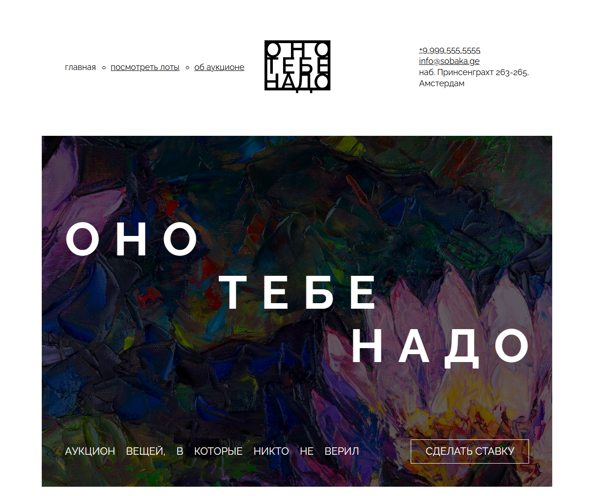
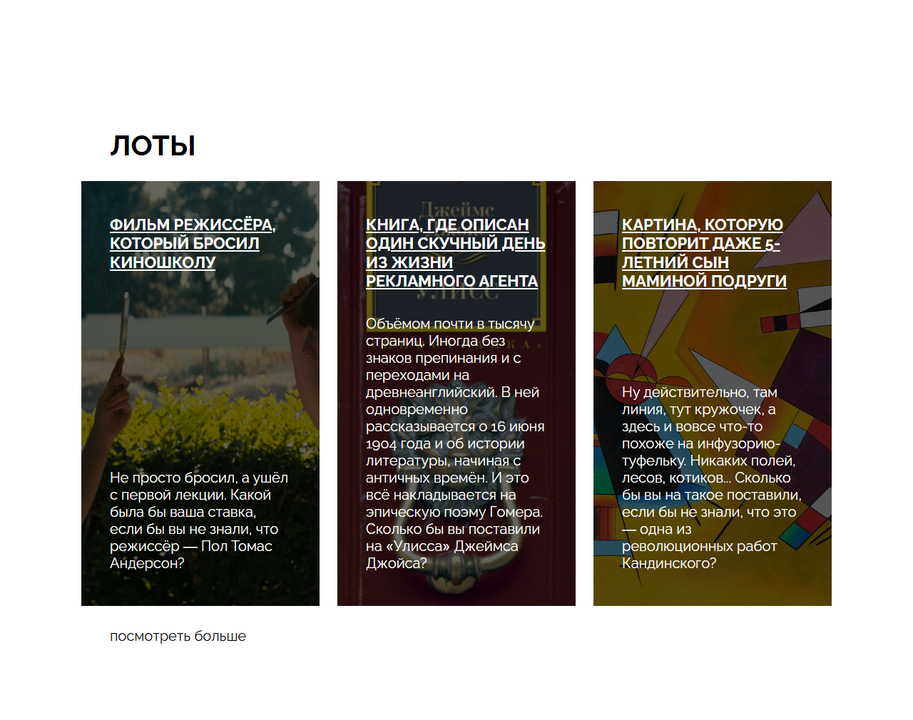
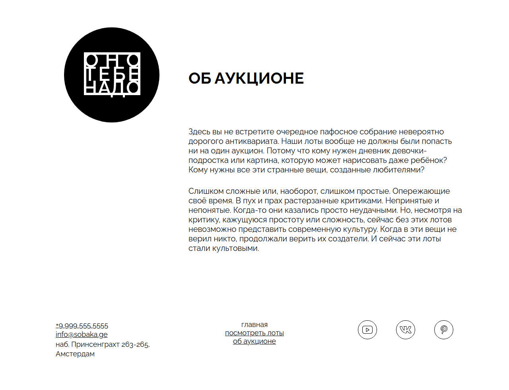
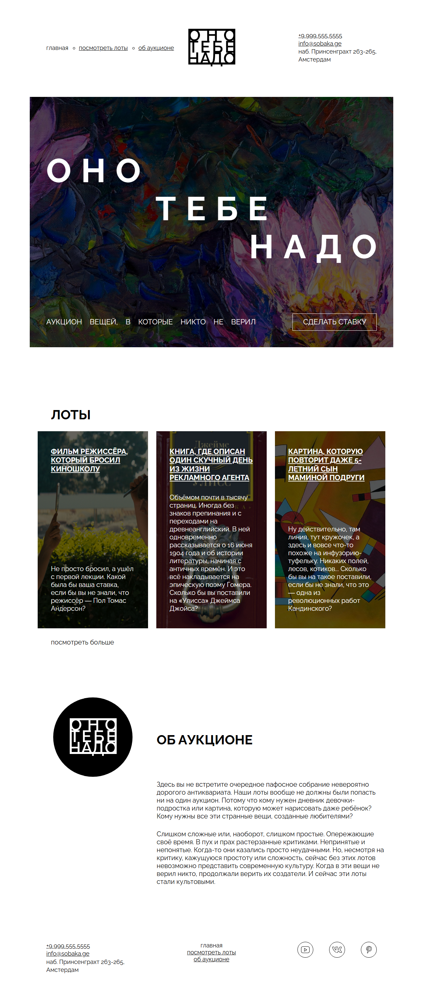

# Проектная работа: Вёрстка страницы «Оно тебе надо»

## 1. Описание проекта и цель работы

Проект представляет собой вёрстку одностраничного сайта интернет-аукциона по предоставленному дизайн-макету. 

**Цель работы:** закрепление практических навыков семантической разметки HTML5, построения сеток страницы с использованием Flexbox и CSS Grid, реализации методологии БЭМ и стилизации компонентов на чистом CSS.

---

## 2. Стек технологий

- **HTML5**: использование семантических тегов (`header`, `main`, `section`, `article`, `nav`, `address`, `footer`).
- **CSS3**:
  - CSS Grid (двухмерные сетки для макроструктуры).
  - Flexbox (одномерные сетки для микроразметки, списков и центрирования элементов).
  - Позиционирование (`position: absolute`, `position: relative`, свойство `inset`).
  - Типографика (подключение локальных шрифтов `@font-face`, управление `letter-spacing`, `word-spacing`, `line-height`).
- **Методология БЭМ**: структурирование CSS-классов по схеме Блок-Элемент-Модификатор.
- **Git**: контроль версий.

---

## 3. Выполненные задачи и этапы реализации

В ходе выполнения работы были реализованы следующие модули и функциональные решения:

### 3.1. Семантическая структура страницы
- Разметка страницы выполнена с соблюдением требований доступности и семантики HTML5.
- Контактная информация в шапке и подвале вынесена в специализированный тег `<address>`.
- Реализована якорная навигация по ключевым секциям страницы (`#lots`, `#about`).

### 3.2. Секция обложки (`cover`)
- Реализован акцентный заголовок с посимвольным форматированием и выравниванием строк по разным сторонам (влево, по центру, вправо) с использованием свойств `letter-spacing` и `text-align`.
- Добавлен фоновый слой с затемнением (`.overlay`) через абсолютное позиционирование для обеспечения контрастности текста.
- Стилизована кнопка действия («Сделать ставку») и блок описания.

### 3.3. Каталог лотов (`lots`)
- Разметка списка карточек выполнена с использованием тегов списков `<ul>`, `<li>` и смысловых контейнеров `<article>`.
- Раскладка списка организована с помощью Flexbox (`flex-wrap: wrap`, `gap: 25px`).
- Индивидуальные фоновые изображения для карточек заданы через классы-модификаторы БЭМ (`card_type_film`, `card_type_book`, `card_type_picture`).
- Каждая карточка лота обёрнута ссылкой для обеспечения интерактивности.

### 3.4. Информационный блок «Об аукционе» (`about`)
- Построена двухколоночная сетка с использованием `CSS Grid`: фиксированная колонка под логотип (334px) и адаптивная колонка для текстового описания.
- Стилизован круглый графический блок под векторный логотип.

### 3.5. Шапка (`header`) и подвал (`footer`)
- Использована трёхколоночная сетка `CSS Grid` (`1fr min-content 1fr`) для строгого центрирования логотипа и меню, а также выравнивания контактных данных и соцсетей по краям.
- Стилизован список ссылок на социальные сети (YouTube, VK, Pinterest) с использованием SVG-иконок.

---

## 4. Структура файлов проекта

```text
ono-tebe-nado-ad/
├── fonts/               # Локальные файлы шрифтов (Raleway) и fonts.css
├── images/              # Графические ресурсы (SVG-иконки, изображения лотов, обложка)
├── styles/
│   ├── global.css       # Базовые стили и сбросы
│   └── style.css        # Стили страницы и компонентов
├── screenshots/         # Снимки экранов готовой вёрстки
├── index.html           # Исходный код HTML-страницы
└── README.md            # Документация к проекту
```

---

## 5. Иллюстрации вёрстки

### 5.1. Шапка и главный экран (Cover)


### 5.2. Каталог лотов (Lots)


### 5.3. Секция «Об аукционе» и подвал (About & Footer)


### 5.4. Общий вид страницы целиком


---

## 6. Инструкция по запуску

1. Клонировать репозиторий:
   ```bash
   git clone https://github.com/VasiliiPlatonov/ono-tebe-nado-ad.git
   ```
2. Открыть файл `index.html` в веб-браузере (Google Chrome, Mozilla Firefox, Safari) или запустить локальный сервер (например, VS Code Live Server).

---

## 7. Информация об авторе

- **Студент:** Василий Платонов
- **Репозиторий:** [VasiliiPlatonov/ono-tebe-nado-ad](https://github.com/VasiliiPlatonov/ono-tebe-nado-ad)
